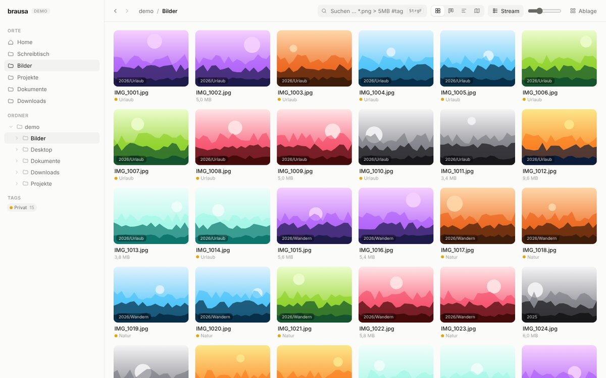
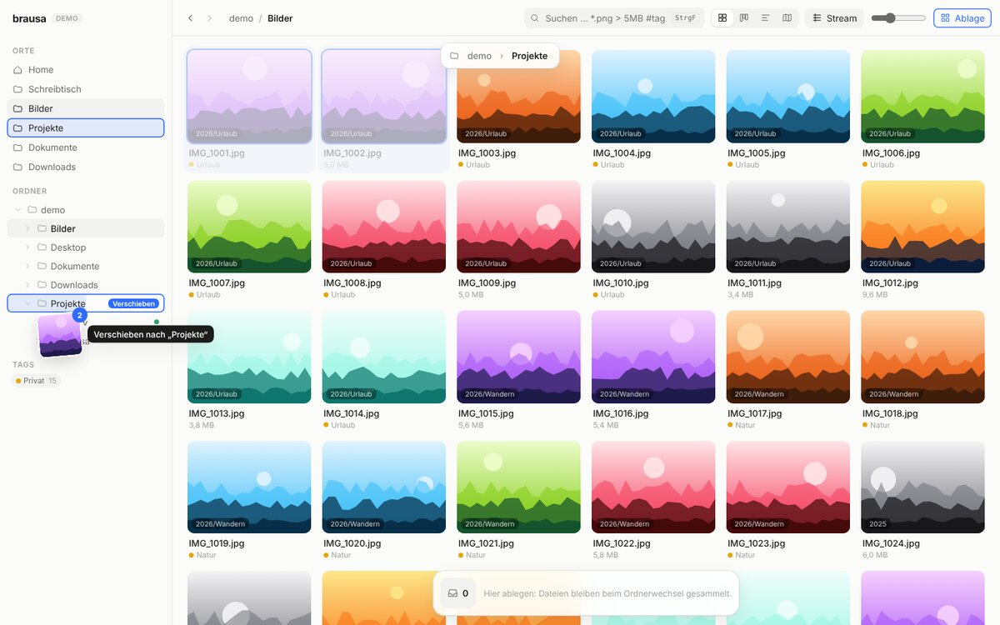
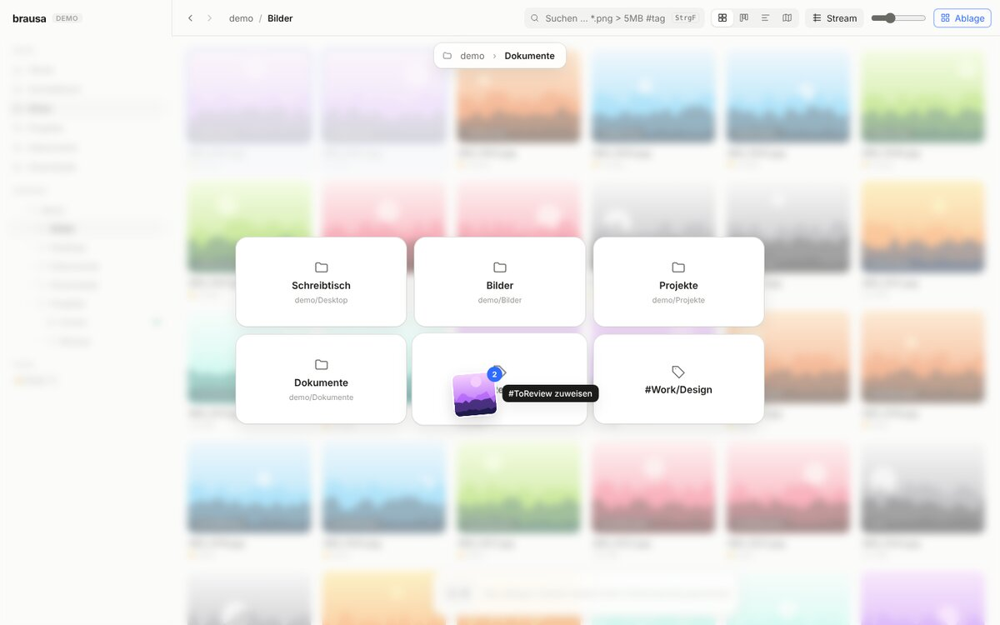
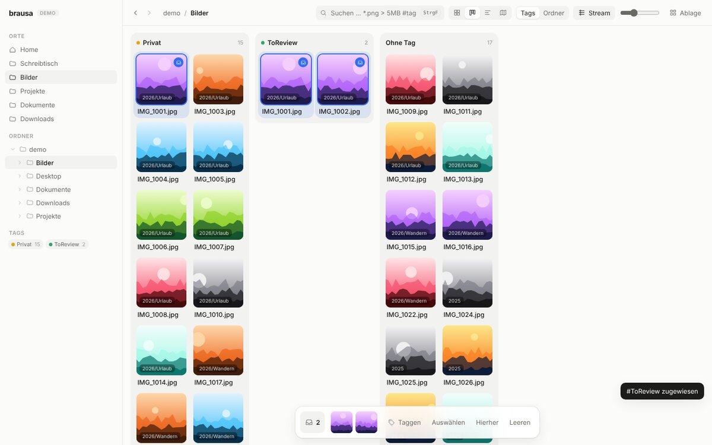
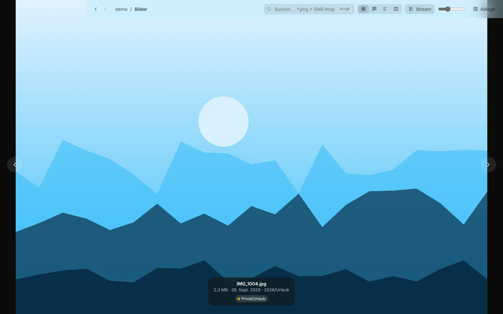

**Deutsch** · [English](README.md)

# brausa

Ein visueller, plattformunabhängiger Datei-Browser für macOS, Windows und Linux.
Er ist für schnelles Sortieren per Drag & Drop gebaut, mit portablen Tags ohne
Lock-in und flachen Bild-Streams statt tiefer Ordnerbäume.

> Vollständiges Konzept, Architektur und Roadmap: **[docs/KONZEPT.md](docs/KONZEPT.md)**



| Ziehen in den Baum (aufklappen beim Hovern, Breadcrumb-Leiste) | Ablage-Raster |
|---|---|
|  |  |
| **Kanban nach Tags** | **Vorschau fließt unter die Toolbar** |
|  |  |

## Installieren

Installer für macOS, Windows und Linux gibt es unter [Releases](https://github.com/lasjoh-toho/brausa/releases).

> **Experimentelle Software.** brausa ist eine Vorab-Version und wurde nach bestem Wissen und Gewissen erstellt. Trotzdem kann sie Fehler enthalten und arbeitet direkt mit Ihren Dateien. Die Nutzung erfolgt auf eigene Gefahr; soweit gesetzlich zulässig, wird keine Verantwortung oder Haftung übernommen. Bitte vorher eine Datensicherung anlegen und zuerst mit Testordnern ausprobieren.

brausa ist nicht bei Apple oder Microsoft signiert, deshalb muss man den ersten Start freigeben. Wie das geht, steht in [LIESMICH für macOS](packaging/LIESMICH-macOS.txt) (liegt auch im DMG) und [LIESMICH für Windows](packaging/LIESMICH-Windows.txt) (Hinweis im Installer, Datei im Programmordner).

Die Oberfläche folgt der Sprache des Systems (Deutsch oder Englisch, sonst Englisch) und lässt sich in den Einstellungen umstellen (Zahnrad oben in der Seitenleiste). Kurz nach dem Start sucht brausa nach Updates und installiert sie auf Wunsch (für Maintainer: [docs/UPDATES.md](docs/UPDATES.md)).

## Was schon geht

| Bereich | Funktion |
|---|---|
| **Ordnerbaum** | Klappt beim Ziehen über einem Ordner nach ~0,5 s auf und danach wieder zu. **Dual-Zone-Drop:** linke Hälfte verschiebt (mit ⌥ bzw. Strg: kopiert), rechte Hälfte überträgt Tags und Farbe des Ordners. |
| **Breadcrumb-Drop** | Beim Ziehen erscheint oben eine Pfadleiste; jedes Segment ist ein Ablageziel. |
| **Ablage-Raster** | Datei auf **Ablage** in der Toolbar ziehen öffnet ein konfigurierbares N×M-Raster aus Ordnern und Tags. Ein Klick auf „Ablage“ öffnet die Einstellungen dazu. |
| **Stream** | Unterordner werden zu einer durchgehenden Bildwand mit Pfad-Badge pro Kachel. Ordner aus dem Baum auf die Fläche ziehen filtert auf diesen Zweig (Funnel). Daneben wählt **Alle Arten ▾** eine Dateiart (Medien, Bilder, Videos, Audio, PDF, Text und Code, Webseiten, Office) und schaltet dabei Stream ein: so sieht man z. B. alle Videos aus allen Unterordnern. |
| **Liste mit Vorschau** | Die klassische Drei-Spalten-Ansicht (zweites Symbol in der Ansichtsleiste): links Orte, Projekte und Ordnerbaum, in der Mitte eine Liste mit Name, Datum, Größe und Art, rechts die Vorschau der markierten Datei mit Größe, Daten, Ort und Tags. Klick auf eine Spaltenüberschrift sortiert (noch einmal: umgekehrt), ↑/↓ blättert durch die Liste (mit ⇧ erweitert die Auswahl), Leertaste zeigt groß. Ziehen, Umbenennen, Kontextmenü und Ablegen auf Ordner funktionieren wie in der Kachelansicht; die Grenze zur Vorschau lässt sich verschieben. |
| **Sortieren** | Das Menü neben *Alle Arten* sortiert alle Ansichten nach Name, Geändert, Erstellt, Aufgenommen (EXIF, sonst Änderungsdatum), Größe oder Art; der Knopf daneben dreht die Richtung um. Ordner stehen immer vorn, die Wahl bleibt gespeichert. |
| **Ansichten** | Stream-Grid, Kanban (Spalten nach Tags oder Unterordnern, Ziehen zwischen Spalten setzt den Tag um), Zeitachse (nach Monat), **Kalender**, **Karte** (OpenStreetMap; Fotos mit GPS aus EXIF, Marker in der Nähe werden zusammengefasst). |
| **Kalender-Heatmap** | Zoombar: alle Jahre → Jahr (Tage) → Monat (mit Foto pro Tag). **Klick auf eine Jahreszahl** öffnet statt der Jahresübersicht ein Tagesband über alle Jahre (beim gewählten Jahr), mit allen Wochentagen, hervorgehobenem Wochenende und der Summe je Wochentag. Das Band scrollt waagerecht, Rahmen gehen über den Jahreswechsel; × führt zurück zu allen Jahren. Doppelklick oder ⌘/Strg + Scrollen bzw. Pinch zoomt. **Ziehen über Zellen setzt einen Zeitfilter**, der in allen Ansichten gilt. In der Tages-Heatmap ist das ein **Rahmen** über Wochen und Wochentage: ein Rahmen über die Montagszeile von Juli bis Oktober wählt nur diese Montage; ⌘/Strg + Ziehen fügt einen weiteren Rahmen hinzu (z. B. die Sonntage), ein Klick auf *Mo … So* schaltet einzelne Wochentage um. Wählbar nach Änderungs-, Erstellungs- oder Aufnahmedatum (EXIF). |
| **Dateien** | Doppelklick öffnet in der Standard-App, „Im Finder/Dateimanager zeigen“, Umbenennen (F2, macOS ↵; bei mehreren markierten Dateien **Stapel-Umbenennen**, siehe unten), Papierkorb (Entf, macOS ⌘⌫), neuer Ordner (⌘/Strg+⇧N), Kontextmenü per Rechtsklick. |
| **Stapel-Umbenennen** | Mehrere Dateien markieren, F2 (macOS ↵) oder Rechtsklick → *… Objekte umbenennen*. Ein **Muster** mit Platzhaltern (`{name}`, `{n}`, `{n:3}` für 001, `{datum}` und `{zeit}` aus Aufnahme- oder Änderungsdatum, `{ordner}`) bildet den neuen Namen, die Endung bleibt. Dazu **Ersetzen** (auch mit regulärem Ausdruck), Startnummer und Schreibweise (klein, GROSS, Wörter Groß). Die **Vorschau** zeigt jeden neuen Namen und markiert Konflikte (doppelt, gibt es schon, unerlaubte Zeichen), bevor etwas passiert. Namen lassen sich auch untereinander tauschen; Rückgängig über die Meldung. |
| **Vorschaubilder** | Werden im Rust-Kern verkleinert, gecacht und erst geladen, wenn die Kachel sichtbar wird. Hochkant-Fotos werden laut EXIF gedreht. |
| **Live-Aktualisierung** | Änderungen durch andere Programme (Sync-Clients, Downloads) erscheinen automatisch. |
| **Auswahl** | Klick, Shift-Bereich, ⌘/Strg-Toggle, Lasso, ⌘/Strg+A, **Auswahl per Muster** (`*.png > 5MB`, `#ToReview`, `modified < 30d`, `ext:jpg,png`, `is:video`, `is:medien`, `-is:bild`, `-#done`). |
| **Ablage-Tray** | Dateien aus beliebigen Ordnern sammeln (Drag oder `S`). Der Inhalt bleibt beim Navigieren erhalten und lässt sich als Gruppe verschieben oder taggen. |
| **Zweites Panel** | Das Symbol links neben *Ablage* öffnet rechts ein zweites Panel mit einem anderen Ordner (Orte und Projekte im Menü, ⇄ tauscht die Ordner beider Seiten). Dateien und Ordner zieht man in beide Richtungen: auf die Liste oder einen Unterordner im Panel, auf die Hauptansicht oder in Baum, Orte und Projekte. ⌥/Strg kopiert statt zu verschieben, Rückgängig über die Meldung. Die Grenze zur Hauptansicht lässt sich mit der Maus verschieben (wird beim Überfahren farbig). |
| **Web-Fenster** | Die Weltkugel in der Toolbar öffnet rechts ein Web-Fenster für Seiten aus dem Internet (Adresse oder Suchbegriff). Es ist **abgeschottet**: eigene Cookies und Logins, getrennt vom normalen Browser, und kein Zugriff auf brausa oder deine Dateien. **Downloads** und **Speichern** (Seite als HTML) landen im ersten Ordner des offenen Projekts bzw. im aktuellen Ordner und gehören dann zum Projekt. **Auf die Map** legt markierten Text als Snippet (sonst die Seite als Karte) mit Link auf die Projektmap; ein Klick darauf öffnet die Seite wieder. **Lesezeichen und Verlauf pro Projekt:** Der Stern in der Adresszeile merkt sich die Seite, *Lesezeichen* und die Uhr zeigen Lesezeichen und Verlauf des offenen Projekts (bzw. des Projekts, zu dem der aktuelle Ordner gehört) mit Suche; die Lesezeichen stehen auch auf der Startseite des Web-Fensters. **Lokale Websites:** Rechtsklick auf eine HTML-Datei → *Im Web-Fenster öffnen*; brausa stellt den Ordner nur auf diesem Rechner unter einer zufälligen Adresse bereit, Links und nachgeladene Dateien funktionieren, Skripte laufen nur, wenn sie für den Ordner erlaubt sind (Knopf oben rechts). |
| **Archive** | ZIP-, tar- und tar.gz-Dateien öffnen sich per Doppelklick **wie Ordner**: durchblättern, Stream, Filter, Vorschau mit der Leertaste (Bilder, PDF, Text, Medien), Doppelklick öffnet eine Datei in der Standard-App. Dateien oder Ordner aus dem Archiv in einen Ordner, ins zweite Panel oder in den Baum ziehen **packt sie aus**. Dateien auf ein Archiv oder in einen geöffneten Archivordner ziehen **packt sie ein** (als Kopie), Entf **löscht im Archiv**; beides nach Rückfrage, die bisherige Fassung des Archivs kommt in den Papierkorb. Rechtsklick → *komprimieren* legt aus Dateien und Ordnern ein ZIP an. |
| **Duplikate** | Rechtsklick auf die freie Fläche → *Duplikate finden* (oder auf einen Ordner → *Duplikate in „…“ finden*) vergleicht die angezeigten Dateien samt Unterordnern, in einem Projekt alle Dateien des Projekts; Suche und Filter gelten mit (z. B. nur Bilder). Verglichen wird der Inhalt: erst die Größe, dann ein schneller und schließlich ein vollständiger Prüfwert, gleiche Dateien unter mehreren Namen (Hardlinks) zählen nicht. Die Fläche zeigt dann nur die Gruppen gleicher Dateien, oben steht, wie viel Platz frei würde. **Überzählige auswählen** markiert alle bis auf eine Datei je Gruppe (stehen bleibt die, die nicht wie eine Kopie heißt, sonst die älteste; sie steht vorn), Entf legt sie in den Papierkorb, *Fertig* beendet die Suche. |
| **Tags** | `T` öffnet die Quick-Tag-Leiste mit Autovervollständigung, zuletzt benutzten Tags und Farben. Hierarchische Tags (`Work/Design/UI` erscheint auch unter `#Work`). Gespeichert im zentralen Index (siehe Projekte); Tags im Dateinamen (`Foto[urlaub strand].jpg`) werden mitgelesen. |
| **Projekte** | Projekte sind **unabhängig von Ordnern**: frei benannte Sammlungen (+ bei *Projekte* in der Seitenleiste). Dateien und Ordner von überall auf ein Projekt ziehen fügt sie hinzu, **ohne sie zu verschieben**; ein Ordner gehört mit seinem ganzen Inhalt dazu. Ein Klick zeigt alle Dateien des Projekts in allen Ansichten (Stream, Kanban, Kalender, Karte, Projektmap). Entf nimmt eine Datei nur aus dem Projekt heraus, auf der Festplatte ändert sich nichts. Dateien bleiben Mitglied, auch wenn sie im Finder/Explorer verschoben oder umbenannt werden. Umbenennen per Doppelklick oder ✎, Löschen mit × (die Dateien bleiben). Ordner, die früher Projekte waren, werden automatisch zu Projekten mit diesem Ordner. |
| **Intelligente Ordner** | Suche, Art-Filter, Stream und Kalender-Rahmen zusammen mit dem Ordner oder Projekt speichern: Sobald ein Filter gesetzt ist, erscheint unter *Intelligente Ordner* „Aktuelle Ansicht speichern“ (oder +). Ein Klick stellt alles wieder her, der offene intelligente Ordner ist hervorgehoben. Der Tooltip zeigt, was gespeichert ist; ◎ ersetzt die Filter durch die aktuelle Ansicht, ✎ oder Doppelklick benennt um, × entfernt (rückgängig über die Meldung). Umbenannte oder verschobene Ordner werden nachgeführt. |
| **Index** | Tags, Farben und Verknüpfungen liegen in einem zentralen Index (lesbar, sortiert); brausa erkennt Dateien, die in anderen Programmen verschoben oder umbenannt wurden, über Datei-ID und Prüfsumme wieder. |
| **Projektmap** | Unendliche, zoombare Fläche pro Projekt (Symbol ganz rechts in der Ansichtsleiste), gespeichert bei den Programmdaten von brausa (bei früheren Ordner-Projekten weiter in `<Ordner>/.brausa/maps/`). Die Map gehört zum geöffneten Projekt, sonst zu einem Projekt, das den aktuellen Ordner enthält, sonst zum zuletzt benutzten. Doppelklick legt eine Karte an (Titel + Markdown-Text). **Karte auf eine andere ziehen macht sie zur Unterkarte** (⌥/Alt hält sie auf ihrer Ebene). Mit dem Punkt am rechten Rand zieht man **Pfeile**, auch über Ebenen hinweg; Pfeile lassen sich beschriften. Mausrad zoomt stufenlos, `↵` fliegt in eine Karte, `Esc` eine Ebene hinauf, die Breadcrumb zeigt, wo man ist. Farben, Größe ändern, Rückgängig/Wiederholen. Mehrere Maps pro Projekt. |
| **Dateien auf der Map** | Das Ordner-Symbol oben rechts öffnet die Dateien des Projekts. Datei (auch aus Ordnerbaum oder Ablage) auf die Map ziehen ergibt eine Karte mit Vorschaubild; Doppelklick öffnet sie in der Standard-App. Auf den **rechten Rand** einer Karte gezogen, wird die Datei mit der Karte **verknüpft**. Umgekehrt verknüpft eine Karte, die man auf eine Datei in der Liste oder Ablage zieht, sich mit ihr. Karten merken sich Dateien über den Index: im Finder verschoben oder umbenannt, bleibt die Verknüpfung erhalten. |
| **Leser und Snippets** | PDFs, HTML-, Markdown- und Textdateien öffnen sich (Doppelklick in der Dateiliste oder auf der Karte) im **Leser links neben der Map**. Text markieren und auf die Map ziehen ergibt ein **Snippet** mit Rücksprung: Klick auf das Snippet öffnet die Quelle an genau der Stelle und lässt sie aufleuchten; alle Snippets eines Dokuments bleiben darin markiert. Snippets an die **Ober- oder Unterkante** eines anderen ziehen **stapelt** sie (wie in LiquidText); herausziehen löst sie wieder. HTML wird ohne Skripte und Formulare angezeigt. |
| **TiddlyWiki (Bags und Recipes)** | Unter *Wikis* in der Seitenleiste stellt man ein Wiki aus **Bags** zusammen, wie im MultiWikiServer: Projektmaps (Karten werden zu Tiddlern mit `brausa-id`, Unterkarten zu `list`, Pfeile zu `brausa-links` für tw5-graph) und **gemeinsame Bags** (Glossar, Personen …), die mehrere Wikis teilen. Ziel ist ein Ordner- oder Einzeldatei-Wiki, das man in **TiddlyDesktop-RS** öffnet. **Abgleichen** (↻) holt Änderungen aus dem Wiki zurück und schreibt dann alle Bags ins Wiki. Kartentexte und Umbenennungen gehen zurück in die Map, alles andere landet wie beim MultiWikiServer im eigenen Bag des Wikis und **überdeckt** dort gemeinsame Tiddler. Das Werkzeug **Überdeckungen** (Ebenen-Symbol neben *Wikis*) zeigt diese mit Zeilenvergleich und löst sie gezielt auf: für alle übernehmen, zusammenführen, verwerfen oder als Variante behalten. **Plugins sind eingebaut** (Markdown, tw5-graph mit Pinboard und Kanban): Maps erscheinen im Wiki ohne Installation als Pinboard und Kanban. Konflikte bleiben als Kopie erhalten; Einzeldatei-Wikis werden vorher gesichert. |
| **Kanban für Karten** | „Kanban“ in der Auswahlleiste schickt Karten ins Projekt-Kanban (Map/Kanban oben rechts umschalten). Spalten = Status, Karten zwischen Spalten ziehen, eigene Spalten anlegen; ein Klick zeigt die Karte auf der Map. |
| **Vorschau** | Doppelklick oder Leertaste: Das Bild wächst aus der Kachel bis unter die Toolbar, die zu Glas in der Bildfarbe wird. ←/→ blättert. Auch **Videos und Audio** (mit Player; welche Formate laufen, hängt vom System ab, sonst „In Standard-App öffnen“), **PDFs**, **Text und Code** (php, js, css, json, py … mit Syntax-Farben; Markdown formatiert oder als Quelltext) und **Webseiten**. Enthält eine Seite Skripte, fragt brausa, ob sie laufen dürfen, mit Warnung; die Antwort lässt sich für die Datei oder den ganzen Ordner merken und über „Ändern“ zurücknehmen. Die Seite läuft abgeschottet ohne Zugriff auf brausa oder andere Dateien. |
| **Rückgängig** | Verschieben lässt sich über die Meldung unten rechts zurücknehmen. |

## Entwickeln

Voraussetzungen: Node ≥ 20 und Rust (stable). Unter Linux zusätzlich
`libwebkit2gtk-4.1-dev libgtk-3-dev librsvg2-dev`
([Tauri-Voraussetzungen](https://v2.tauri.app/start/prerequisites/)).

```bash
npm install
npm run tauri dev        # Desktop-App mit echtem Dateisystem
npm run dev              # nur UI im Browser, mit Demo-Daten (http://localhost:1420)
npm test                 # Domänenkern (Vitest)
npm run check            # Typprüfung
cd src-tauri && cargo test   # Rust-Kern
npm run tauri build      # Installer für das aktuelle Betriebssystem
```

Im Browser läuft automatisch das `DemoBackend` mit generierten Beispielbildern.
Damit lässt sich die Oberfläche ohne Rust-Toolchain entwickeln.

## Aufbau

```
src/lib/core/       reines TypeScript: Tags, Muster-Auswahl, Ansichten, Pfade (+ Tests)
src/lib/backend/    Backend-Interface · TauriBackend · DemoBackend
src/lib/state/      App-Zustand (Svelte-5-Runes) · Drag-Controller
src/lib/components/ Sidebar, Baum, Toolbar, Canvas, Tray, Overlays
src-tauri/src/      Rust: Dateisystem, Sidecar-Metadaten, Tauri-Commands (+ Tests)
docs/KONZEPT.md     Konzept, Architektur, Roadmap
```

## Tastenkürzel

| Taste | Aktion |
|---|---|
| `T` | Auswahl (oder Ablage) taggen |
| `S` | Auswahl in die Ablage legen |
| `Leertaste` | Vorschau |
| Doppelklick, `⌘/Strg+O` | In Standard-App öffnen (Ordner: hineinwechseln) |
| `F2` (macOS auch `↵`) | Umbenennen |
| `Entf` (macOS `⌘⌫`) | In den Papierkorb |
| `⌘/Strg+⇧N` | Neuer Ordner |
| `⌘/Strg+F` | Suche oder Muster |
| `⌘/Strg+A` | Alles auswählen |
| `⌫` bzw. `⌘/Strg+↑` | Übergeordneter Ordner |
| `⌘/Strg+[` / `]` | Zurück / Vor |
| `Esc` | Funnel bzw. Auswahl aufheben, Drag abbrechen |
| `⌥` (macOS) bzw. `Strg` beim Ziehen | Kopieren statt Verschieben |

**In der Projektmap**

| Taste | Aktion |
|---|---|
| Doppelklick (frei / in einer Karte) | Neue Karte bzw. Unterkarte |
| Doppelklick auf den Kartentitel, `F2` | Bearbeiten (`⌘/Strg+↵` oder `Esc` beendet) |
| `N` | Neue Karte in der Mitte |
| `↵` | In die ausgewählte Karte hineinfliegen |
| `Esc` | Auswahl aufheben, sonst eine Ebene hinauf |
| `0` | Ganze Map zeigen |
| `Entf` / `⌫` | Karte oder Pfeil löschen |
| `⌘/Strg+Z`, `⌘/Strg+⇧Z` | Rückgängig, Wiederholen |
| Ziehen mit `⌥`/Alt | Verschieben, ohne zu verschachteln |
